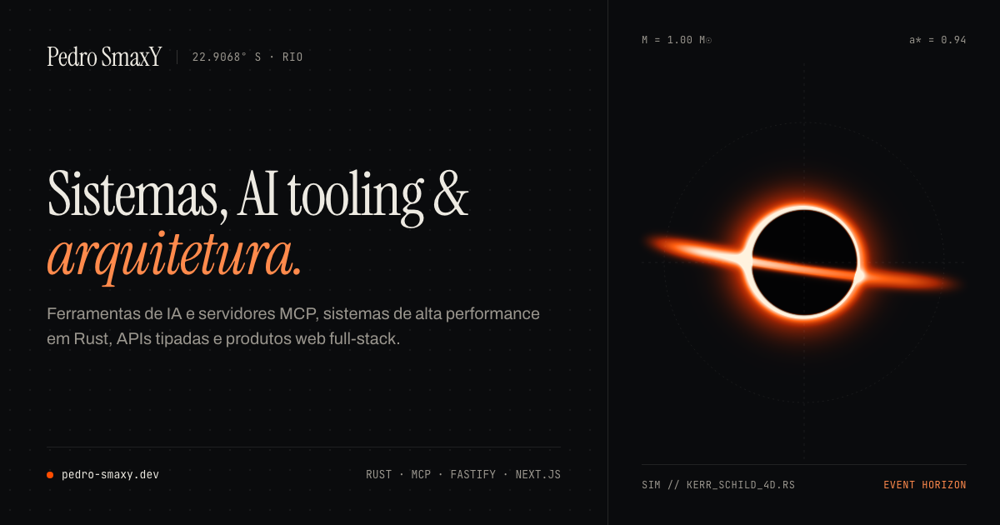
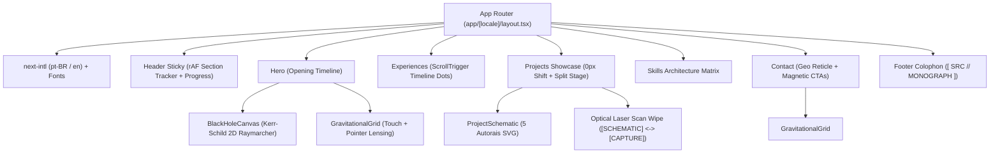

<div align="center">



# PEDRO NOVAIS // RELATIVISTIC MONOGRAPH

**Engenharia de Software · AI Tooling (MCP / SDD) · Sistemas de Baixo Nível & Arquitetura Full-Stack**

[](https://pedro-smaxy-dev.vercel.app)
[](https://nextjs.org/)
[](https://react.dev/)
[](https://www.typescriptlang.org/)
[](https://tailwindcss.com/)
[](https://gsap.com/)
[](./LICENSE)

[Acessar Portfólio Live](https://pedro-smaxy-dev.vercel.app) · [English Version (`/en`)](https://pedro-smaxy-dev.vercel.app/en) · [GitHub (@PedroSmaxY)](https://github.com/PedroSmaxY)

</div>

---

## Visão Geral

Este repositório contém o código-fonte do portfólio de **Pedro Novais** (`pedro-smaxy.dev`), projetado sob a linguagem visual **Relativistic Monograph** — um sistema editorial escuro inspirado em instrumentos científicos, monografias técnicas e simulação física em terminal.

Em vez de utilizar vídeos ou fundos genéricos em WebGL pesado, toda a interatividade visual do site é executada com zero dependências 3D externas por meio de **motores próprios em Canvas 2D**, **esquemáticas vetoriais animadas em SVG** e uma **coreografia de motion unificada via GSAP**.

---

## Arquitetura de Subsistemas



---

## Motores de Física & Canvas Interativos

### 1. `BlackHoleCanvas` ([`components/black-hole-canvas.tsx`](./components/black-hole-canvas.tsx))
Port direto em TypeScript + Canvas 2D do simulador relativístico em Rust (`black-hole-ascii-simulation`), renderizado em tempo real a 60 FPS no Hero:
- **Geodésica Nula 3D:** Integração em 26 passos da equação reduzida de Binet em métrica de Schwarzschild (`d²x/dλ² = -1.5 · r_s · |h|² / |x|⁵ · x`), capturando absorção pelo horizonte de eventos (`r ≤ 1.04`) e múltiplos cruzamentos equatoriais do disco de acreção.
- **Doppler Beaming Relativístico & GalacticSky:** Cálculo de fator Doppler por velocidade tangencial do disco e projection cube-map `6-face + 3×3 Worley` ao redor da esfera de fótons para formação nítida dos anéis de Einstein.
- **FOV Responsivo:** Ampliação adaptativa de `tanFov` quando `aspect < 1.25`, mantendo `camDist = 17.5` abaixo do raio de escape (`18.5`) para evitar cortes laterais em laptops estreitos.
- **Modo Duplo & Touch:** Alterna em tempo real entre renderização **ASCII** (malha `96×44` em desktop e `64×34` em telas `< 520px`) e **Half-Block HD** (`136×76` px offscreen sem smoothing) via atalho `[M]` no teclado ou botão tátil; suporta arraste passivo no touch (`touch-pan-y`) sem bloquear a rolagem vertical.

### 2. `GravitationalGrid` ([`components/gravitational-grid.tsx`](./components/gravitational-grid.tsx))
Campo vetorial de pontos 2D presente em `Hero` e `Contact`:
- **Curvatura Local & Núcleo Térmico:** Atrai os pontos em direção ao cursor/toque dentro de um raio de `125px` (`maxPull = 7px`), acendendo o núcleo em brasa relativística.
- **Disciplina 0% Idle:** O loop `requestAnimationFrame` inicia apenas no evento (`pointermove`, `pointerdown`, `touchstart`, `touchmove`) e hiberna automaticamente assim que a energia decai para `strength < 0.005`.
- **Pulso Inicial em Touch + `prefers-reduced-motion`:** Em dispositivos móveis (`!finePointer`), executa um pulso gravitacional suave na entrada em viewport (`IntersectionObserver`) e hiberna em seguida; respeita integralmente acessibilidade vestibular.

---

## Sistema de Design (`RELATIVISTIC MONOGRAPH`)

### Paleta de Tokens

| Token | Hex | Aplicação |
|---|---|---|
| **Obsidian Canvas** | `#0A0B0D` | Superfície base global e áreas editoriais |
| **Instrument Surface** | `#0F1013` / `#07080A` | Cartões técnicos, palcos de diagrama e painéis de telemetria |
| **Warm Technical Paper** | `#EDEAE2` | Tipografia principal e linhas divisórias (`10%`–`22%` opacity) |
| **Muted Ash** | `#9A968E` / `#636059` | Metadados, índices de linha, coordenadas e rótulos |
| **Relativistic Ember** | `#FF4D00` | Pontos de ativação, links primários, feixe óptico e marcadores ativos |
| **Accretion Amber** | `#FF8A4C` | Ênfase itálica editorial e curvas de telemetria secundárias |

### Tríade Tipográfica ([`app/[locale]/layout.tsx`](./app/%5Blocale%5D/layout.tsx))
- **`Instrument Serif`** (`--font-serif`): Títulos principais com tracking negativo e itálico de contraste editorial.
- **`Archivo`** (`--font-sans`): Corpo de leitura com medidas limitadas (`55ch`–`68ch`).
- **`JetBrains Mono`** (`--font-mono`): Telemetria, diagramas SVG, timestamps (`tabular-nums`), badges e controles de instrumento.

---

## Direção de Motion & Esquemáticas Vetoriais

O sistema de movimento ([`lib/motion.ts`](./lib/motion.ts)) segue o eixo **Calm × Sharp** (`ease: "expo.out"`, zero *bounce*/*overshoot*) encapsulado em `createMotionScope` sobre `gsap.matchMedia()`:

1. **5 Esquemáticas Autorais em SVG ([`components/project-schematic.tsx`](./components/project-schematic.tsx)):**
   - **01 · Black Hole ASCII:** Anatomia gravitacional Kerr-Schild com anéis de Einstein superior/inferior e disco Doppler.
   - **02 · ABNT MCP:** Auditor normativo FastMCP (`NBR 14724 · 10520:23 · 6023 · IBGE 1993`) conectado a wireframe A4 (`3-3-2-2 CM`) e compiladores Typst/abnTeX2.
   - **03 · FinAI (TCC):** Pipeline de ingestão `OFX/CSV`, anonimizador `LGPD Zero-PII`, kernel `BYOK AES-256-GCM`, curva vetorial de fluxo & poupança e módulos financeiros.
   - **04 · Solar System ASCII:** Observatório orbital animado com 5 órbitas keplerianas concêntricas via `<animateTransform>` nativo e HUD real do simulador em Rust.
   - **05 · FURIA CS2 FanBot:** Console de comandos do bot em Python (`/proximaspartidas`, `/resumo`, `/elenco`), camada Fastify Cache + Docker Compose e telemetria de rating da line-up CS2.
2. **`Optical Laser Scan Wipe` ([`components/sections/projects.tsx`](./components/sections/projects.tsx)):**
   - Nos projetos com captura real (`Black Hole`, `FinAI`, `Solar System`, `FURIA`), alternar entre `LIVE_SCHEMATIC` e `RENDER_CAPTURE` dispara uma varredura bidirecional com feixe `#FF4D00` sincronizado a `clipPath` (`0.48s`) e *scramble* de caracteres no cabeçalho (`SCRAMBLE_CHARS` via `requestAnimationFrame`).
   - Geometria da coluna de metadados travada para **0px de variação vertical** entre todos os 5 projetos em desktop (`1024px–1440px`).

---

## Estrutura do Projeto

```text
pedro-smaxy.dev/
├── app/
│   └── [locale]/
│       ├── globals.css          # Tokens Tailwind v4, animações SVG (flowDash) e acessibilidade
│       ├── layout.tsx           # Fontes, metadados bilíngues e NextIntlClientProvider
│       └── page.tsx             # Composição das seções editoriais
├── components/
│   ├── black-hole-canvas.tsx    # Motor 2D Geodésico (ASCII adaptativo + Half-Block HD)
│   ├── gravitational-grid.tsx   # Campo gravitacional 2D sob demanda (Pointer + Touch)
│   ├── project-schematic.tsx    # 5 esquemáticas vetoriais SVG dedicadas
│   ├── scroll-progress.tsx      # Indicador de progresso de leitura
│   ├── language-switcher.tsx    # Alternador PT-BR / EN
│   └── sections/                # Header, Hero, About, Experiences, Projects, Skills, Education, Contact, Footer
├── i18n/                        # Configuração next-intl (routing.ts, request.ts)
├── lib/
│   ├── config.ts                # Contatos, coordenadas (Petrópolis, RJ) e matriz de stack
│   ├── get-skill-icon.tsx       # Ícones por categoria técnica
│   └── motion.ts                # Tokens Calm × Sharp e wrapper createMotionScope
├── messages/
│   ├── pt-BR.json               # Conteúdo completo em Português (Brasil)
│   └── en.json                  # Conteúdo completo em Inglês
├── public/                      # Capturas nativas 16:9, OG images bilíngues, favicons e CVs (PT/EN)
└── proxy.ts                     # Middleware de roteamento por locale
```

---

## Execução Local

```bash
# 1. Instalar dependências
pnpm install

# 2. Servidor de desenvolvimento (Turbopack)
pnpm dev

# 3. Verificações de qualidade e build de produção
pnpm lint
pnpm build
pnpm start
```

---

<div align="center">

Construído por **[Pedro Novais](https://github.com/PedroSmaxY)** · Petrópolis, RJ (`22.3886° S · 43.1331° W`) · [Licença MIT](./LICENSE)

</div>
