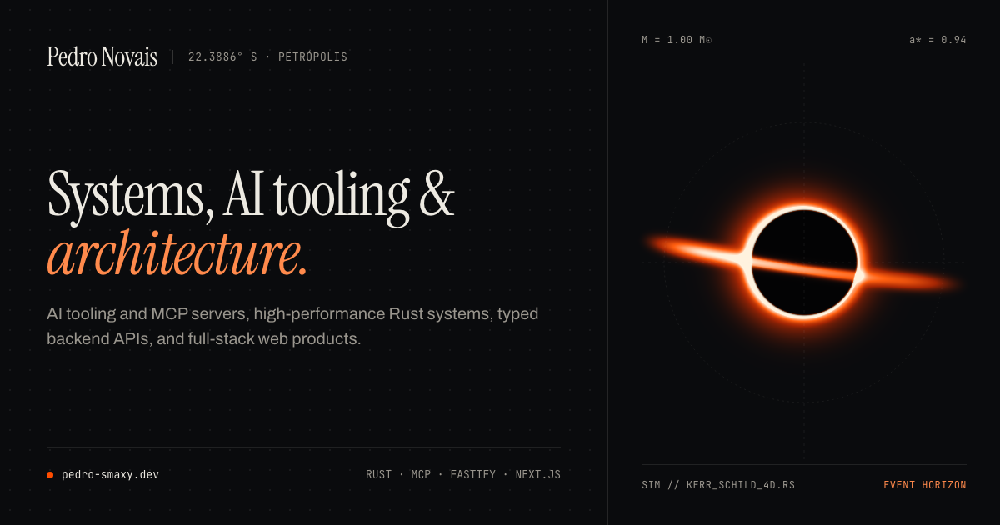
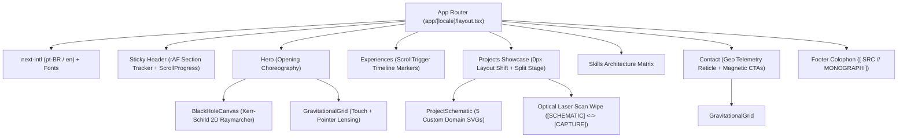

<div align="center">



# PEDRO NOVAIS // RELATIVISTIC MONOGRAPH

**Software Engineering · AI Tooling (MCP / SDD) · Low-Level Systems & Full-Stack Architecture**

[](https://pedro-smaxy-dev.vercel.app/en)
[](https://nextjs.org/)
[](https://react.dev/)
[](https://www.typescriptlang.org/)
[](https://tailwindcss.com/)
[](https://gsap.com/)
[](./LICENSE)

[Live Portfolio (`/en`)](https://pedro-smaxy-dev.vercel.app/en) · [Versão em Português (`/pt-BR`)](https://pedro-smaxy-dev.vercel.app/pt-BR) · [GitHub (@PedroSmaxY)](https://github.com/PedroSmaxY)

</div>

---

## Overview

This repository houses the source code for **Pedro Novais**'s personal engineering portfolio (`pedro-smaxy.dev`), designed under the **Relativistic Monograph** visual language — a dark technical-editorial system inspired by scientific instruments, technical monographs, and terminal-native physics simulations.

Instead of relying on static video loops or heavy third-party WebGL runtimes, every interactive surface runs on **custom 2D Canvas physics engines**, **bespoke animated SVG domain schematics**, and a **unified GSAP motion architecture**.

---

## Subsystem Architecture



---

## Interactive Physics & Canvas Engines

### 1. `BlackHoleCanvas` ([`components/black-hole-canvas.tsx`](./components/black-hole-canvas.tsx))
A direct TypeScript + HTML5 Canvas 2D port of the Rust terminal raymarcher (`black-hole-ascii-simulation`), running live at 60 FPS inside the Hero viewport:
- **3D Null Geodesics:** 26-step integration of the reduced Schwarzschild Binet equation (`d²x/dλ² = -1.5 · r_s · |h|² / |x|⁵ · x`), resolving event-horizon capture (`r ≤ 1.04`) and multiple equatorial accretion-disk crossings.
- **Relativistic Doppler Beaming & GalacticSky:** Evaluates tangential velocity beaming across the sheared accretion rings plus a 6-face cube-map `3×3 Worley` starfield projection for crisp Einstein rings near the photon sphere.
- **Responsive Viewport FOV:** Dynamically widens `tanFov` when `aspect < 1.25` while holding `camDist = 17.5` inside the escape radius (`18.5`) so narrow laptop viewports never clip the accretion disk.
- **Dual Renderer & Touch Support:** Toggles live between **ASCII** (`96×44` desktop grid, adaptive `64×34` below `520px` for legibility and mobile CPU savings) and **Half-Block HD** (`136×76` offscreen pixel buffer) via `[M]` on keyboard or tap toggle; supports passive finger dragging (`touch-pan-y`) on touchscreens without hijacking vertical scroll.

### 2. `GravitationalGrid` ([`components/gravitational-grid.tsx`](./components/gravitational-grid.tsx))
A 2D gravitational dot-matrix field backing `Hero` and `Contact`:
- **Local Lensing & Ember Core:** Pulls grid points toward the pointer or touch coordinate within a `125px` radius (`maxPull = 7px`), shifting nearby points toward warm relativistic ember (`#FF8A4C` / `#FF4D00`).
- **0% Idle CPU Discipline:** The `requestAnimationFrame` loop wakes on `pointermove`, `pointerdown`, `touchstart`, or `touchmove`, then automatically hibernates when `strength < 0.005`.
- **Touch Welcome Wave & Reduced Motion:** Triggers a one-time subtle gravitational pulse when entering the viewport on coarse-pointer devices (`IntersectionObserver`) before hibernating, and honors `prefers-reduced-motion: reduce`.

---

## Design System (`RELATIVISTIC MONOGRAPH`)

### Color Palette

| Token | Hex | Usage |
|---|---|---|
| **Obsidian Canvas** | `#0A0B0D` | Primary global background and editorial surfaces |
| **Instrument Surface** | `#0F1013` / `#07080A` | Technical cards, schematic viewports, and telemetry panels |
| **Warm Technical Paper** | `#EDEAE2` | Primary copy, display serif headings, and hairline dividers (`10%`–`22%`) |
| **Muted Ash** | `#9A968E` / `#636059` | Metadata, coordinates, line indices, and passive telemetry |
| **Relativistic Ember** | `#FF4D00` | Interactive triggers, optical scan laser, active timeline nodes |
| **Accretion Amber** | `#FF8A4C` | Editorial italic emphasis and secondary telemetry strokes |

### Typography Triad ([`app/[locale]/layout.tsx`](./app/%5Blocale%5D/layout.tsx))
- **`Instrument Serif`** (`--font-serif`): Display headings with tight negative tracking and italic accent contrast.
- **`Archivo`** (`--font-sans`): Technical prose constrained to `55ch`–`68ch` measure.
- **`JetBrains Mono`** (`--font-mono`): Telemetry headers, SVG blueprints, `tabular-nums` timestamps, badges, and instrument controls.

---

## Motion Direction & Bespoke Vector Schematics

The motion language ([`lib/motion.ts`](./lib/motion.ts)) enforces a **Calm × Sharp** curve (`ease: "expo.out"`, zero bounce/overshoot) wrapped in `createMotionScope` over `gsap.matchMedia()`:

1. **5 Custom Domain SVG Schematics ([`components/project-schematic.tsx`](./components/project-schematic.tsx)):**
   - **01 · Black Hole ASCII:** Kerr-Schild gravitational lensing geometry with upper/lower Einstein ring halos and Doppler disk gradients.
   - **02 · ABNT MCP:** FastMCP normative auditor (`NBR 14724 · 10520:23 · 6023 · IBGE 1993`) wired to an A4 academic sheet blueprint (`3-3-2-2 cm`) and Typst/abnTeX2 compilers.
   - **03 · FinAI (Capstone):** `OFX/CSV` statement ingestion, `LGPD Zero-PII` sanitizer, `BYOK AES-256-GCM` kernel, cashflow & savings curve, and product modules.
   - **04 · Solar System ASCII:** Animated Keplerian observatory with 5 concentric orbits driven by native SVG `<animateTransform>` and Rust HUD telemetry.
   - **05 · FURIA CS2 FanBot:** Python Telegram command console (`/proximaspartidas`, `/resumo`, `/elenco`), Fastify TTL cache + Docker Compose stack, and CS2 roster rating bars.
2. **`Optical Laser Scan Wipe` ([`components/sections/projects.tsx`](./components/sections/projects.tsx)):**
   - On projects with live captures (`Black Hole`, `FinAI`, `Solar System`, `FURIA`), toggling between `LIVE_SCHEMATIC` and `RENDER_CAPTURE` sweeps a `#FF4D00` laser beam synced with a bidirectional `clipPath` reveal (`0.48s`) and a `requestAnimationFrame` character scramble (`SCRAMBLE_CHARS`).
   - Desktop right-column metadata geometry is locked for **0px height delta** across all 5 projects (`1024px–1440px`).

---

## Project Structure

```text
pedro-smaxy.dev/
├── app/
│   └── [locale]/
│       ├── globals.css          # Tailwind v4 tokens, SVG keyframes (flowDash), accessibility
│       ├── layout.tsx           # Google Fonts, bilingual metadata, NextIntlClientProvider
│       └── page.tsx             # Editorial 12-column section composition
├── components/
│   ├── black-hole-canvas.tsx    # 2D geodesic raymarcher (adaptive ASCII + Half-Block HD)
│   ├── gravitational-grid.tsx   # On-demand 2D gravitational field (pointer + passive touch)
│   ├── project-schematic.tsx    # 5 custom animated domain SVG schematics
│   ├── scroll-progress.tsx      # Reading progress bar
│   ├── language-switcher.tsx    # PT-BR / EN switcher
│   └── sections/                # Header, Hero, About, Experiences, Projects, Skills, Education, Contact, Footer
├── i18n/                        # next-intl routing & request config
├── lib/
│   ├── config.ts                # Contact metadata, Petrópolis coordinates, skill matrix
│   ├── get-skill-icon.tsx       # Category icons
│   └── motion.ts                # Calm x Sharp tokens & gsap.matchMedia wrapper
├── messages/
│   ├── en.json                  # English locale strings
│   └── pt-BR.json               # Portuguese (Brazil) locale strings
├── public/                      # 16:9 native captures, bilingual OG banners, favicons, CVs
└── proxy.ts                     # Locale routing middleware
```

---

## Local Development

```bash
# 1. Install dependencies
pnpm install

# 2. Run development server (Turbopack)
pnpm dev

# 3. Lint, type-check & production build
pnpm lint
pnpm build
pnpm start
```

---

<div align="center">

Built by **[Pedro Novais](https://github.com/PedroSmaxY)** · Petrópolis, RJ (`22.3886° S · 43.1331° W`) · [MIT License](./LICENSE)

</div>
